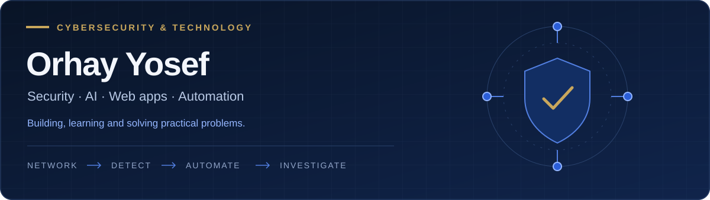

  

# Orhay Yosef

**Aspiring SOC / SIEM Analyst · Defensive Security Portfolio**

I’m building a portfolio around security log analysis, detection logic and forensic triage. These four projects explore how network events become investigation leads, with reproducible examples and documented limitations.

[LinkedIn](https://www.linkedin.com/in/orhay-yosef) · [Explore my repositories](https://github.com/OYDeadpoolife?tab=repositories)

## The defensive workflow

**01 Network visibility → 02 Detection → 03 Automation → 04 Investigation**

Each project works independently. Together, they follow a shared, fictional lab scenario.

### 01 / Network visibility

#### [pfSense Network Security Lab](https://github.com/OYDeadpoolife/pfsense-network-security-lab)

A segmented WAN / LAN / DMZ / management network design, with firewall policies, synthetic logs and a packet capture for analysis practice.

**Focus:** Network segmentation · Firewall logs · Bash / awk · Packet analysis  
**Scope:** Documented design and synthetic samples. The pfSense VM setup has **not been built or validated**.

[Read the lab design](https://github.com/OYDeadpoolife/pfsense-network-security-lab#readme)

### 02 / Detection

#### [SOC Detection & SIEM Lab](https://github.com/OYDeadpoolife/soc-siem-detection-lab)

Linux and Windows log analysis with 12 documented detections, MITRE ATT&CK mappings, false-positive notes and an investigation walkthrough.

**Focus:** Python · Sysmon / auditd · SPL · KQL / EQL · Analyst triage  
**Scope:** Synthetic data with tested Python reference logic, as documented in the repository. Splunk and Elastic queries are **not validated in those platforms**.

[Follow the investigation](https://github.com/OYDeadpoolife/soc-siem-detection-lab/blob/main/docs/investigation-walkthrough.md)

### 03 / Automation

#### [Security Log Automation](https://github.com/OYDeadpoolife/security-log-automation)

`seclog` reads Linux authentication logs, flags suspicious authentication and privilege activity, and produces JSON, CSV and Markdown reports.

**Focus:** Bash · awk · Linux authentication · Explainable detection rules  
**Scope:** Read-only log analysis with synthetic demo data. A learning and portfolio tool with documented test results and detection limits.

[Explore the toolkit](https://github.com/OYDeadpoolife/security-log-automation#readme)

### 04 / Investigation

#### [DFIR Forensics Toolkit](https://github.com/OYDeadpoolife/dfir-forensics-toolkit)

`dfir-triage` collects file metadata, strings and indicators, compares SHA-256 hashes before and after analysis, and writes a case report.

**Focus:** Bash · Evidence integrity · Indicator extraction · Case documentation  
**Scope:** Synthetic demo evidence. Built-in modules have documented tests; integrations with real binwalk, foremost, bulk_extractor and Volatility are **not yet verified**.

[Explore the triage workflow](https://github.com/OYDeadpoolife/dfir-forensics-toolkit#readme)

---

### Evidence first

These are learning and portfolio projects. Sample incidents, logs and evidence are synthetic. Each repository documents its test results and remaining validation work; the examples do not represent production deployments or real incident-response experience.

**Connect:** [Orhay Yosef on LinkedIn](https://www.linkedin.com/in/orhay-yosef)
